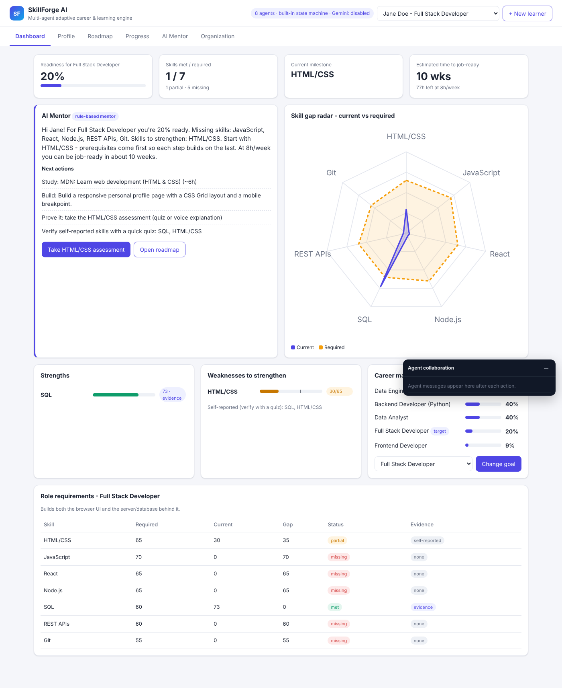
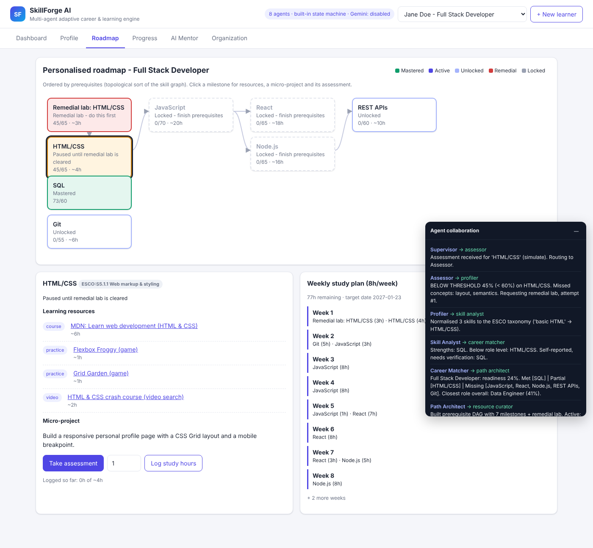
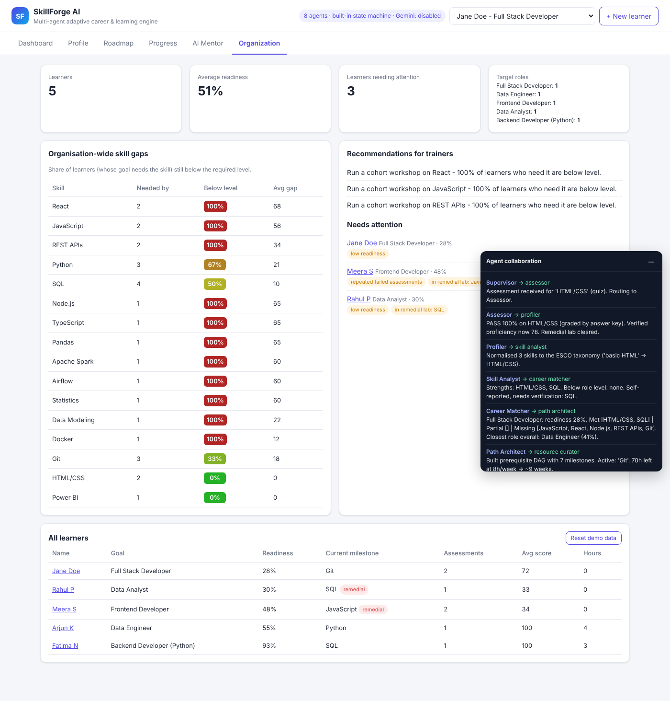
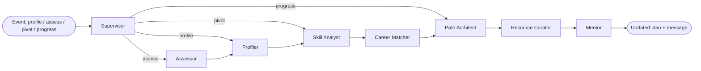

# SkillForge AI - Adaptive Career & Learning Engine

An AI-powered learning platform where **8 specialised agents collaborate** to understand a learner's skills, find the gaps for a target job role, build a prerequisite-ordered learning roadmap, recommend resources, assess progress, and **re-plan automatically** when the learner changes their career goal or performs poorly in an assessment.

  -f59e0b) -555)

| Dashboard | Adaptive remediation | Organisation view |
|---|---|---|
|  |  |  |

---

## Problem
Organisations and universities struggle to see what skills each employee or student lacks, and generic platforms give everyone the same courses regardless of existing skills, progress or career goals.

## What it does - mapped to the expected features

| Requirement | How SkillForge AI delivers it |
|---|---|
| **1. User Profile** | Name, organisation, career goal, weekly study hours, interests, skills with self-rated level, **certifications**, **projects**. Paste a **resume / LinkedIn text** and the Profiler extracts skills automatically. |
| **2. Skill Analysis** | Every skill gets a 0-100 proficiency score with a **confidence level**: *self-reported* → *evidence* (certification/project) → *verified* (passed assessment). Strengths, weaknesses and **weak concepts** (from wrong answers) are listed. |
| **3. Career Matching** | Compares proficiency with role benchmarks (required level per skill) → readiness %, met / partial / missing skills, radar chart, and readiness for **all 5 roles** ("which role am I closest to?"). |
| **4. Learning Recommendations** | Topologically sorted **skill DAG** (prerequisites first). Each milestone has a course, tutorial, hands-on practice, video and a **micro-project**. A **weekly study plan** and job-ready **ETA** come from the learner's available hours. |
| **5. Progress Tracking** | Assessment history, readiness-over-time chart, score chart, study-hour logging, activity timeline, milestones-mastered %. |
| **6. AI Mentor** | Personalised guidance after every event + next actions, and a **mentor chat** ("why this order?", "how long?", "am I interview-ready?"). |
| **Agentic AI** | 8 agents in a LangGraph state machine, with an **agent collaboration log** shown live in the UI. |
| **Adapts to career change** | Changing the goal re-runs the matcher and architect - mastered skills are kept, transferable skills are highlighted. |
| **Adapts to poor performance** | Score < 60% → downstream milestones pause, a **remedial lab** targeting *only the missed concepts* is injected. 2nd failure → materials switch to **video + hands-on first**, and weak **prerequisites are re-opened** for a refresh. |

### New ideas beyond the brief
- **Evidence-based proficiency**: self-claims are treated as "unverified" until the learner proves them - the mentor nudges them to verify.
- **Concept-level remediation**: every quiz question is tagged with a concept, so remediation targets exactly what was misunderstood.
- **Voice "explain it" assessment**: learners explain a concept out loud (browser speech recognition, Chrome/Edge) - graded by Gemini, or by a concept rubric offline. Doubles as interview practice.
- **Organisation dashboard** for universities/companies: cohort-wide skill-gap heat map, learners needing attention (low readiness, repeated failures, remedial), and workshop recommendations for trainers.
- **Time-aware planning**: weekly schedule and target date from the learner's real study hours.
- **Runs anywhere**: works fully offline without an API key; Gemini only enhances it. Falls back to a built-in state machine if LangGraph isn't installed, and to a zero-dependency server if `pip install` is blocked.

---

## Agent architecture



| Agent | Responsibility |
|---|---|
| Supervisor | Receives each event, applies goal changes / study logs, routes to the right agent |
| Profiler | Normalises raw skills ("js", "basic HTML", "postgres") to an ESCO-style taxonomy; combines self-rating, certifications, projects and verified scores |
| Skill Analyst | Strengths, weaknesses, weak concepts, unverified claims |
| Career Matcher | Gap vs target role, readiness %, ranking across all roles, transferable skills on pivot |
| Path Architect | Prerequisite DAG (Kahn's topological sort), statuses, remedial injection, weekly plan + ETA |
| Resource Curator | Courses / tutorials / practice / video + micro-project per milestone; targeted remedial resources; format switch after repeated failure |
| Assessor | Grades quizzes (answer key never sent to the browser) and spoken/written explanations (Gemini or concept rubric) |
| Mentor | Personalised message + next actions (Gemini-rewritten when available); mentor chat |

Every agent writes to a shared trace, shown in the **Agent collaboration** panel.

---

## Run it locally

### Windows (easiest)
1. Install **Python 3.10+** from https://www.python.org/downloads/ - tick **"Add python.exe to PATH"**.
2. Download this repo (green **Code** button → *Download ZIP*, then extract) or `git clone` it.
3. Double-click **`run.bat`**. It creates a virtual environment, installs packages and opens http://localhost:8000.

### Manual (any OS)
```bash
cd backend
python -m venv .venv
# Windows: .venv\Scripts\activate      macOS/Linux: source .venv/bin/activate
pip install -r requirements.txt
uvicorn main:app --reload --port 8000
```
Open http://localhost:8000 (dashboard) and http://localhost:8000/docs (API docs).

**No internet for pip?** Run `python devserver.py` - same app, Python standard library only.

### Enable Gemini (optional)
Get a free key at https://aistudio.google.com/apikey, copy `backend/.env.example` to `backend/.env` and put your key in it. Restart - the header pill shows `Gemini: active`.

### Tests
```bash
cd backend && python -m pytest -q
```

---

## 3-minute demo script
1. **Dashboard (Jane Doe - the sample scenario)**: Python + SQL + basic HTML → Full Stack Developer. Missing JavaScript, React, Node.js; basic HTML flagged as a weakness; readiness %, radar, ETA.
2. **Profile**: show the Profiler's evidence table; paste resume text → *Extract skills*.
3. **Roadmap**: DAG - JavaScript locked until HTML/CSS reaches working level; open a milestone → resources, micro-project, weekly plan.
4. **Assessment → "Demo: simulate fail (45%)"**: watch the agent log - Assessor → Profiler → … → Path Architect injects a **remedial lab**, dependants pause, Mentor explains.
5. Retake the quiz correctly → remedial cleared, next skills unlock, readiness goes up.
6. **Explain (voice)**: speak an answer → graded with feedback on missed concepts.
7. **Change goal → Data Engineer**: mastered skills preserved, new roadmap instantly.
8. **Organization tab**: cohort skill-gap heat map, at-risk learners, trainer recommendations.

## Project structure
```
backend/
  main.py              FastAPI app (serves API + frontend)
  devserver.py         zero-install fallback server
  skillforge/
    knowledge.py       taxonomy, prerequisites, role benchmarks, resources, quiz bank
    agents.py          the 8 agents
    graph.py           LangGraph wiring (+ built-in fallback runner)
    llm.py             Gemini (google-genai) wrapper with graceful fallback
    service.py         app operations + demo cohort
    routes.py          shared route table
    store.py           SQLite persistence
  tests/test_engine.py
frontend/              index.html, app.js, styles.css (no build step)
```

## API (summary)
`GET /api/health` · `GET /api/meta` · `GET/POST /api/learners` · `GET /api/learners/{id}` · `POST /api/learners/{id}/assess` · `POST /api/learners/{id}/pivot` · `POST /api/learners/{id}/progress` · `POST /api/learners/{id}/chat` · `POST /api/resume/extract` · `GET /api/quiz?skill=` · `GET /api/cohort` · `POST /api/demo/reset`

## Roadmap / future work
Authentication & roles (learner / trainer / admin), PostgreSQL, live job-posting analysis to update role benchmarks, spaced-repetition reviews, LMS integration (Moodle/Coursera links), more roles from the full ESCO/O\*NET taxonomy.
