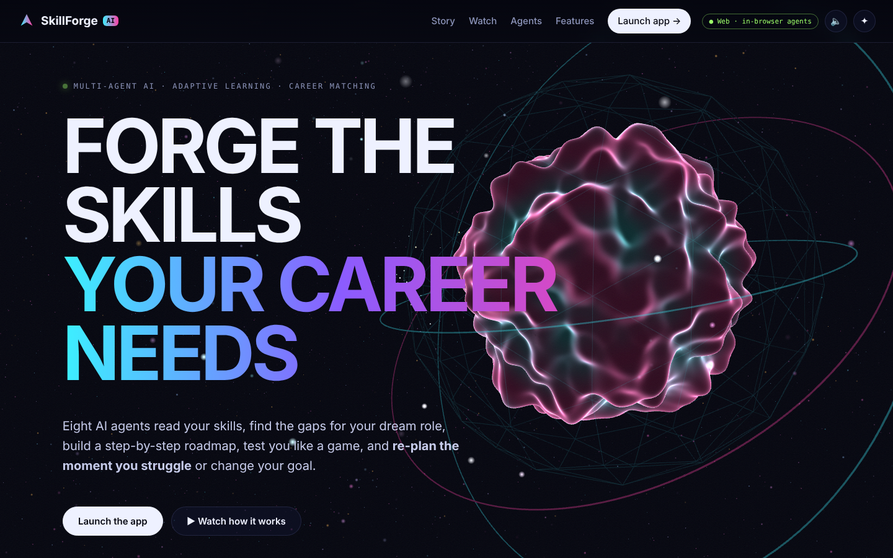
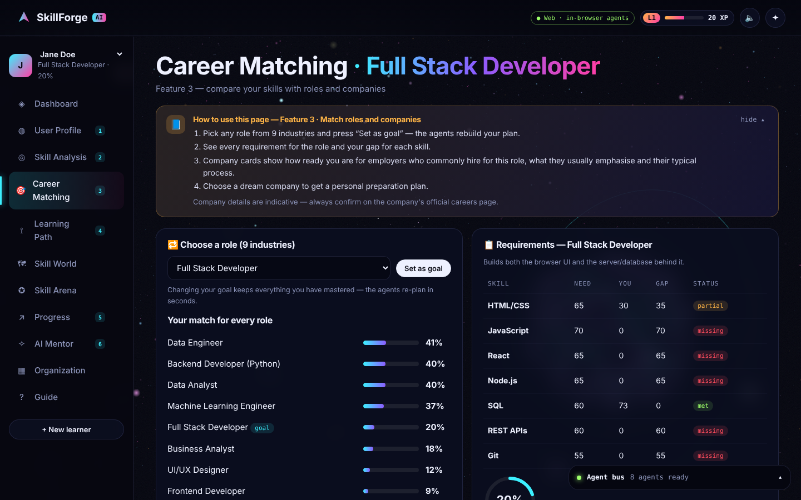
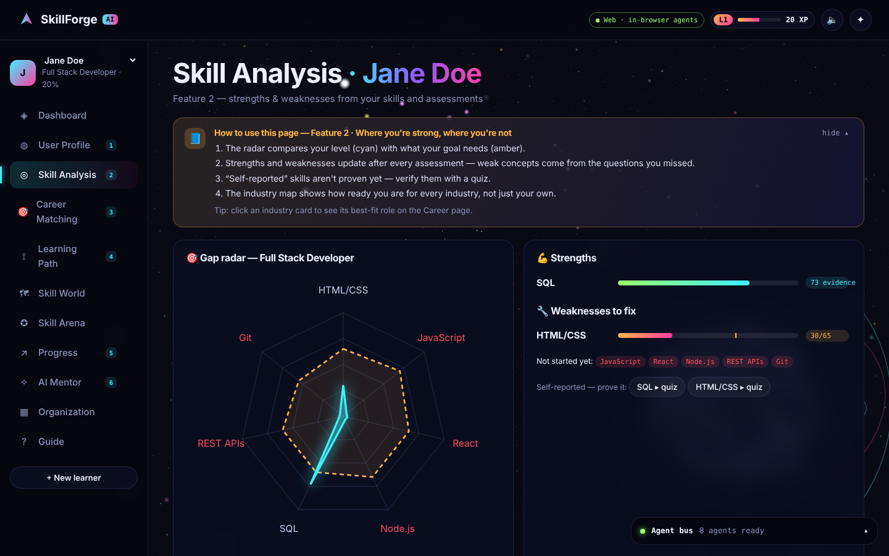
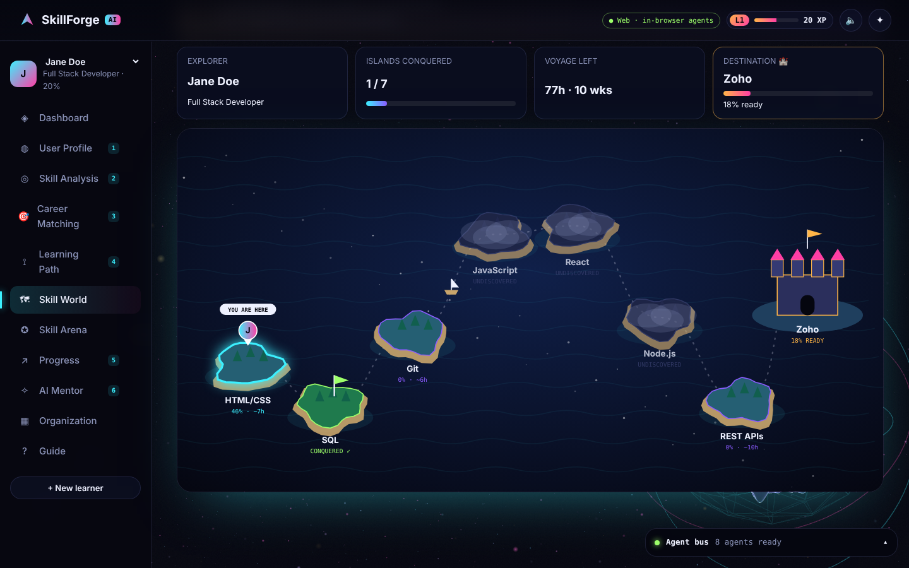
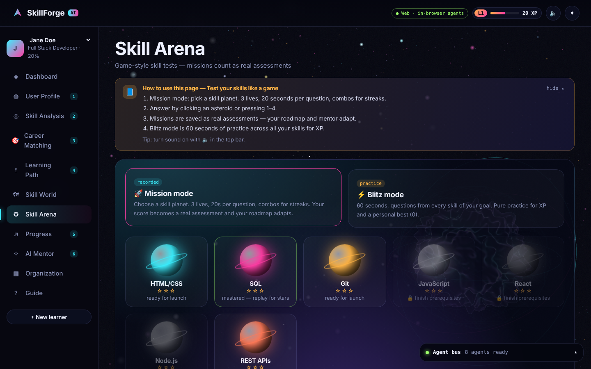

# SkillForge AI — Adaptive Career & Learning Engine

**8 AI agents** read a learner's skills, find the gaps for their dream role **in any industry**, match them to **companies that hire for it**, build a prerequisite-ordered roadmap, test them **like a game**, and **re-plan automatically** when the learner changes goal or performs poorly.

### ▶ Try it now — no installation
**Live web version: https://g-jayakiruthika.github.io/skillforge-ai/**
The same 8 agents run inside your browser, so judges can open the link and use everything immediately. Data stays on their device.

     

| Landing (WebGL) | Dashboard | Career + company matching |
|---|---|---|
|  |  |  |
| **Skill Analysis** | **Skill World map** | **Skill Arena game** |
|  |  |  |

---

## Problem
Organisations and universities can't see what skills each student or employee lacks, and traditional platforms give everyone the same courses regardless of existing skills, progress or career goals.

## Expected features — and where to find them
Each feature is its **own page** with its own address, so it can be opened in a new tab (↗ in the menu).

| # | Requirement | Page | How SkillForge AI delivers it |
|---|---|---|---|
| 1 | **User Profile** | `profile.html` | Name, degree, college, weekly hours, career goal **and dream company**, skills with levels, **certifications**, **projects**. Or paste a resume — the Profiler extracts skills from any industry. |
| 2 | **Skill Analysis** | `analysis.html` | Every skill scored 0–100 with a **confidence level** (self-reported → evidence → verified), strengths, weaknesses, **weak concepts** from wrong answers, and an **industry readiness map** across all 9 industries. |
| 3 | **Career Matching** | `career.html` | Compare with any of **14 roles**; required vs current per skill, your match for every role, **companies that hire for it** with what they emphasise and their typical process, plus a **dream-company preparation plan**. |
| 4 | **Learning Recommendations** | `learn.html` | Prerequisite-sorted **skill DAG**. Each milestone has a course, tutorial, hands-on practice, video and a **micro-project**, plus a **weekly plan** and job-ready date from the learner's hours. |
| 5 | **Progress Tracking** | `progress.html` | Readiness over time, assessment scores vs pass mark, study hours per skill, achievements, XP and levels, full timeline. |
| 6 | **AI Mentor** | `mentor.html` | Guidance after every event + next actions, and a chat grounded in the learner's live plan. |
| ★ | **Agentic AI** | everywhere | 8 agents in a LangGraph state machine; the **Agent bus** shows them collaborating live. |
| ★ | **Adapts to goal change** | `career.html` | Mastered skills are kept, transferable skills highlighted, roadmap rebuilt in seconds. |
| ★ | **Adapts to poor performance** | `arena.html` / any assessment | Below 60% → later milestones pause and a **remedial lab targeting only the missed concepts** is injected. Second failure → materials switch to **video + hands-on** and weak **prerequisites re-open**. |

### Accounts, privacy and security
| Area | What is implemented |
|---|---|
| **Accounts** | Sign up as **student** or **faculty**; sessions in HttpOnly + SameSite cookies; passwords hashed with PBKDF2-HMAC-SHA256 (600,000 rounds). Nobody can sign up as admin. |
| **Who sees what** | A student's profile is private: only the student, faculty **of the same college**, and an admin can open it — and faculty are read-only. The sample learners (Jane Doe and friends) are a clearly-marked open sandbox. |
| **Faculty Q&A** | Students send a question from the Faculty page; it is stored in the database and answered in the faculty portal. Email addresses are never exposed. |
| **Data Consent tab** | Granular switches — Essential (always on), Analytics, Marketing, AI processing — with *Accept all*, *Reject non-essential*, *Save preferences* and a **Last updated** timestamp. Nothing optional runs until the user opts in; switching one off deletes what it collected. |
| **Data Privacy tab** | Plain-language table of every kind of data kept and why (GDPR + India's DPDP Act 2023), your rights, **Download my data** (JSON) and **Delete my account & data** behind a typed confirmation. |
| **AI consent has teeth** | With *AI processing* off, no text is sent to Gemini: the built-in rules grade it on the server instead. |
| **Hardening** | 25-point audit script (`python security_audit.py`): no hardcoded secrets, CSRF origin check, strict CSP and 9 security headers, rate limits with login lockout, parameterised SQL, 0600 database file, sanitised forms, no PII in any log, no third-party trackers. |

### Extra ideas beyond the brief
- **Multi-industry by design** — software, data & AI, mechanical, electronics/embedded, civil, finance, business, marketing & design, healthcare. 41 skills, 14 roles, 9 industries.
- **Company matching** — 30 well-known employers with role-specific emphasis, so a student can prepare for a *specific* company. (Indicative data — always confirm on the company's careers page.)
- **Skill World** (`world.html`) — the roadmap as a game map: islands you've conquered, fog over locked skills, a volcano for the remedial lab, and your dream company's castle at the end.
- **Skill Arena** (`arena.html`) — timed missions with 3 lives, combos and stars; results are recorded as **real assessments** so the agents re-plan. Plus a 60-second Blitz practice mode.
- **Voice "explain it" check** — explain a concept out loud; graded on the ideas covered. Good interview practice.
- **Evidence-based scoring** — self-claims stay "unverified" until proven.
- **Organisation dashboard** (`org.html`) — cohort skill-gap heat map, at-risk learners, trainer recommendations.
- **Immersive UI** — a Three.js WebGL scene that morphs on scroll, portal page transitions, 5 custom cursor styles, a 1-minute animated explainer you can export as video, sound effects, XP and achievements.
- **Runs anywhere** — full offline fallbacks: no API key needed, no LangGraph needed, no server needed.

---

## Agent architecture


| Agent | Responsibility |
|---|---|
| Supervisor | Routes every event to the right agent |
| Profiler | Normalises raw skills (`js`, `tally`, `autocad`, `basic HTML`) to an ESCO-style taxonomy; scores from level + certificates + projects + verified results |
| Skill Analyst | Strengths, weaknesses, weak concepts, unverified claims |
| Career Matcher | Role gap, readiness, all-role ranking, **industry ranking**, **company fit**, dream-company plan |
| Path Architect | Prerequisite DAG (topological sort), statuses, remedial injection, weekly plan + ETA |
| Resource Curator | Course / tutorial / practice / video + micro-project per milestone; targeted remedial resources; format switch after repeated failure |
| Assessor | Grades quizzes, game missions and spoken explanations (the answer key never leaves the server) |
| Mentor | Personalised message, next actions and chat (rewritten by Gemini when a key is present) |

---

## Two ways to run

### A. Web version (zero install) — best for judges
Open **https://g-jayakiruthika.github.io/skillforge-ai/** — or run it locally with any static server:
```bash
cd frontend && python -m http.server 8080     # then open http://localhost:8080
```
The 8 agents run in JavaScript (`frontend/js/engine.js`); data is saved in the browser.

### B. Full version (FastAPI + LangGraph + optional Gemini)
**Windows:** install Python 3.10+ (tick *Add python.exe to PATH*), then double-click **`run.bat`**.

**Any OS:**
```bash
cd backend
python -m venv .venv
# Windows: .venv\Scripts\activate       macOS/Linux: source .venv/bin/activate
pip install -r requirements.txt
uvicorn main:app --reload --port 8000     # http://localhost:8000  ·  /docs for the API
```
No internet for pip? `python devserver.py` runs the same app with the standard library only.

**Enable Gemini (optional):** get a free key at <https://aistudio.google.com/apikey>, copy `backend/.env.example` to `backend/.env`, paste the key, restart. The top-bar pill then shows `Gemini`.

### Tests and audit
```bash
cd backend && python -m pytest -q        # 36 tests
cd backend && python security_audit.py   # 25-point security & code-quality audit
```
`test_parity.py` runs the **same scenarios through both engines** (Python and JavaScript) and fails if any decision — scores, statuses, roadmap, company fit, even the mentor's wording — differs.

---

## 4-minute demo script
1. **Landing** — scroll: the WebGL core morphs through six states. Press **Watch how it works** for the 1-minute animated explainer.
2. **Dashboard** (`app.html`) — *Jane Doe*: Python, SQL, basic HTML → Full Stack Developer, dream company Zoho. 20% ready.
3. **Skill Analysis** — radar, weak concepts, and the **industry map** (she is actually closest to Data & AI).
4. **Career Matching** — company cards and the Zoho preparation plan. Switch the role selector to **Mechanical Design Engineer** to show the platform is not software-only.
5. **Learning Path → Skill World** — the same roadmap as a game map; her avatar stands on HTML/CSS, later islands are in fog.
6. **Skill Arena** — play the HTML/CSS mission. Lose on purpose: watch the **Agent bus** inject a remedial lab and later milestones pause. Then win and see islands unlock.
7. **Progress** and **AI Mentor** — everything has updated.
8. **Organization** — the trainer's view: 9 learners across 6 industries, heat map, at-risk list.
9. Switch learner to **Karthik R** (mechanical) or **Priya M** (commerce) to show another industry end to end.

## Project structure
```
frontend/                 the web version (also served by the backend)
  index.html              landing page
  app.html profile.html analysis.html career.html learn.html
  world.html arena.html progress.html mentor.html org.html guide.html
  js/main.js              pages, routing, portal transitions
  js/engine.js            all 8 agents in the browser (parity-tested)
  js/scene.js             Three.js WebGL world
  js/arena.js js/world.js game modules
  js/explainer.js         animated explainer video
  js/cursor.js js/fx.js   cursor styles, motion toolkit
  js/privacy.js           Data Consent + Data Privacy tabs and the consent gate
  js/theme.js             light/dark, colour per page, text size, contrast, minimal mode
  js/voice.js js/avatars.js  voice agent and the 3D agent dolls
  js/knowledge.js         generated from the Python knowledge base
  vendor/three.module.min.js  Three.js r170 (MIT)
backend/
  main.py                 FastAPI app (API + serves the frontend)
  devserver.py            zero-install fallback server
  export_knowledge.py     knowledge.py -> frontend/js/knowledge.js
  skillforge/
    knowledge.py          taxonomy, prerequisites, roles, resources, quizzes
    industries.py         9 industries, extra roles/skills, 30 employers
    agents.py graph.py    the 8 agents + LangGraph wiring
    llm.py                Gemini (google-genai) with graceful fallback
    service.py routes.py store.py
    institutions.py       231 Tamil Nadu universities & colleges
    auth.py security.py   accounts, roles, sessions, hashing, rate limits, sanitising
  tests/                  test_engine.py · test_parity.py · test_security.py
  security_audit.py       25 checks: secrets, auth, XSS, CSRF, privacy, lint
.github/workflows/pages.yml  deploys frontend/ to GitHub Pages
```

## API
`GET|POST /api/auth/signup|login|logout|demo` · `GET /api/auth/me` · `GET|POST /api/privacy/consent` · `GET /api/privacy/export` · `POST /api/privacy/delete` · `GET /api/directory|institutions|faculty|leaderboard|messages` · `POST /api/faculty/{id}/ask` · `POST /api/messages/{id}/reply` · `POST /api/contact`
`GET /api/health` · `GET /api/meta` · `GET|POST /api/learners` · `GET /api/learners/{id}` · `POST /api/learners/{id}/assess` · `POST /api/learners/{id}/pivot` · `POST /api/learners/{id}/progress` · `POST /api/learners/{id}/chat` · `POST /api/resume/extract` · `GET /api/quiz?skill=` · `POST /api/quiz/check` · `GET /api/cohort` · `POST /api/demo/reset`

## Notes & credits
- The Tamil Nadu institution list (231 universities and colleges) comes from Wikipedia's *List of institutions of higher education in Tamil Nadu*; it is a **starter catalogue**, not the full register of ~2,000 affiliated colleges. Learners whose college is missing can type it in, and more can be appended to `backend/skillforge/institutions.py`.
- Demo faculty accounts have **no shared password** — the portal demo uses a passwordless session that only ever opens the fictional sample learners, and it is disabled when `SKILLFORGE_PUBLIC=1`.
- Company information is **indicative** — roles these employers commonly hire for and skills such roles usually emphasise. Always confirm on the official careers page.
- Learning resources link to free, official sources (MDN, official docs, freeCodeCamp, Khan Academy, NPTEL, Microsoft Learn, Google, Kaggle and similar).
- [Three.js](https://threejs.org/) r170 (MIT) is vendored in `frontend/vendor/`.
- Fonts: Space Grotesk & JetBrains Mono via Google Fonts.

## Future work
Authentication and roles (learner / trainer / admin), PostgreSQL, live job-posting analysis to keep role benchmarks and company data current, spaced-repetition review, LMS integration, more roles from the full ESCO/O*NET taxonomy.
